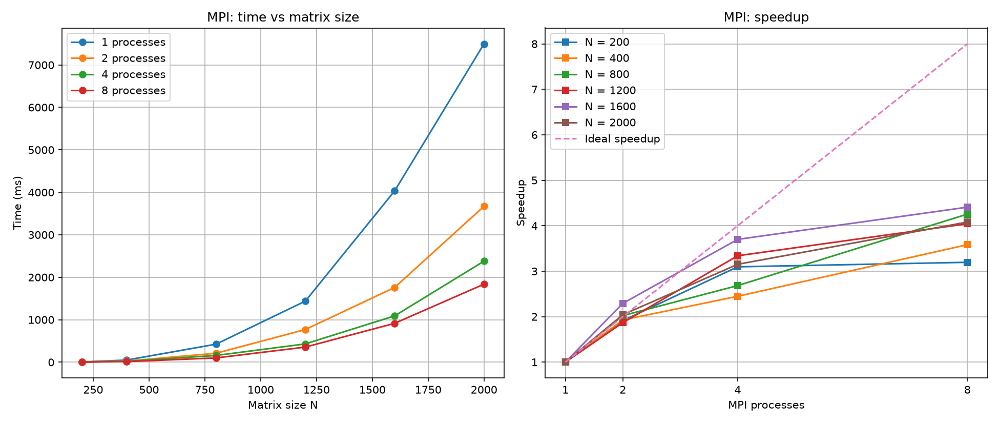

# Lab3 — Умножение матриц с MPI

**Выполнили:** Дарьин Иван Борисович и Эльменкин Виктор Хавьерович

**Группа:** 6213-100503D

В этой работе программа из первой лабораторной была переделана для работы с MPI.
Матрицы делятся по строкам между процессами. Каждый процесс считает свою часть,
а потом результат собирается на нулевом процессе.

## Файлы

| Файл | Для чего нужен |
|---|---|
| `main.cpp` | Чтение матриц, MPI и умножение |
| `CMakeLists.txt` | Сборка проекта |
| `gen.py` | Генерация матриц |
| `verify.py` | Проверка через NumPy |
| `bench.py` | Эксперименты для разных размеров и числа процессов |
| `plot_perf.py` | Графики по CSV |
| `matrix_a.txt`, `matrix_b.txt` | Входные матрицы |
| `result.txt` | Результирующая матрица |
| `benchmark.csv` | Результаты запусков |
| `performance.png` | Графики |

## Как работает программа

Нулевой процесс читает обе матрицы. Матрица B передается всем процессам через
`MPI_Bcast`, строки матрицы A распределяются через `MPI_Scatterv`. После
умножения части результата собираются через `MPI_Gatherv`.

Умножение написано обычными циклами `i, k, j`, как в первой лабораторной.
Сложность алгоритма — O(N³). Время замеряется через `MPI_Wtime`.

## Сборка и запуск

Нужны CMake, компилятор C++11 и установленная реализация MPI (например, Open MPI
или Microsoft MPI).

```bash
cmake -S . -B build
cmake --build build --config Release
python -m pip install -r requirements.txt
python gen.py 800
mpiexec -n 4 .\build\Release\matrix_mpi.exe
python verify.py
```

## Эксперименты

Запуск всех размеров 200, 400, 800, 1200, 1600, 2000 для 1, 2, 4 и 8 процессов:

```bash
python bench.py
python bench.py 1,2,4,8
```

Скрипт запускает программу, проверяет каждый результат через NumPy, сохраняет
таблицу в `benchmark.csv`, строит графики и обновляет таблицу в этом README.

Время включает распределение строк, вычисления и сбор результата. Ускорение
считается относительно запуска с одним MPI-процессом для того же размера.
Эффективность — ускорение, деленное на количество процессов.

## Результаты

Таблица и графики появятся после запуска `python bench.py` на компьютере с MPI.

<!-- BENCHMARK_RESULTS_START -->
| N | Процессы MPI | Время, мс | Ускорение | Эффективность | Max diff | Проверка |
|---:|---:|---:|---:|---:|---:|:---:|
| 200 | 1 | 6.319 | 1.00 | 1.00 | 0.000e+00 | OK |
| 200 | 2 | 3.307 | 1.91 | 0.96 | 0.000e+00 | OK |
| 200 | 4 | 2.041 | 3.10 | 0.77 | 0.000e+00 | OK |
| 200 | 8 | 1.978 | 3.19 | 0.40 | 0.000e+00 | OK |
| 400 | 1 | 49.724 | 1.00 | 1.00 | 0.000e+00 | OK |
| 400 | 2 | 25.804 | 1.93 | 0.96 | 0.000e+00 | OK |
| 400 | 4 | 20.323 | 2.45 | 0.61 | 0.000e+00 | OK |
| 400 | 8 | 13.879 | 3.58 | 0.45 | 0.000e+00 | OK |
| 800 | 1 | 423.787 | 1.00 | 1.00 | 0.000e+00 | OK |
| 800 | 2 | 209.578 | 2.02 | 1.01 | 0.000e+00 | OK |
| 800 | 4 | 157.944 | 2.68 | 0.67 | 0.000e+00 | OK |
| 800 | 8 | 99.595 | 4.26 | 0.53 | 0.000e+00 | OK |
| 1200 | 1 | 1437.878 | 1.00 | 1.00 | 0.000e+00 | OK |
| 1200 | 2 | 769.253 | 1.87 | 0.93 | 0.000e+00 | OK |
| 1200 | 4 | 430.626 | 3.34 | 0.83 | 0.000e+00 | OK |
| 1200 | 8 | 355.662 | 4.04 | 0.51 | 0.000e+00 | OK |
| 1600 | 1 | 4035.214 | 1.00 | 1.00 | 0.000e+00 | OK |
| 1600 | 2 | 1760.248 | 2.29 | 1.15 | 0.000e+00 | OK |
| 1600 | 4 | 1090.935 | 3.70 | 0.92 | 0.000e+00 | OK |
| 1600 | 8 | 915.439 | 4.41 | 0.55 | 0.000e+00 | OK |
| 2000 | 1 | 7496.161 | 1.00 | 1.00 | 0.000e+00 | OK |
| 2000 | 2 | 3670.753 | 2.04 | 1.02 | 0.000e+00 | OK |
| 2000 | 4 | 2378.872 | 3.15 | 0.79 | 0.000e+00 | OK |
| 2000 | 8 | 1837.138 | 4.08 | 0.51 | 0.000e+00 | OK |


<!-- BENCHMARK_RESULTS_END -->

## Вывод

В программе добавлено распределение матрицы по строкам между MPI-процессами.
Корректность результата проверяется отдельно через NumPy. По таблице и графикам
можно сравнить время работы и ускорение при увеличении числа процессов.
