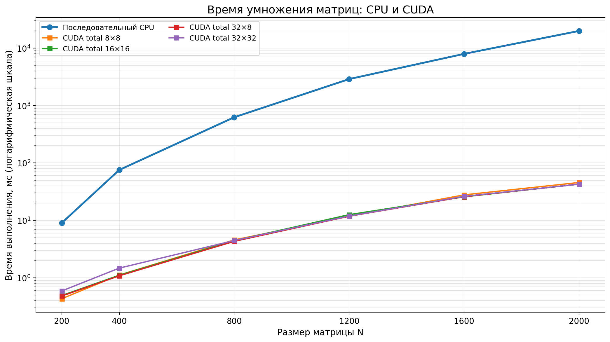
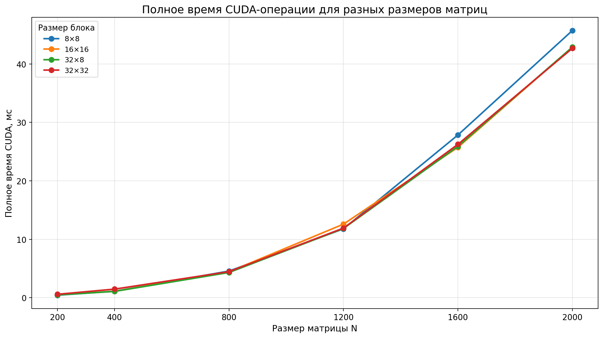
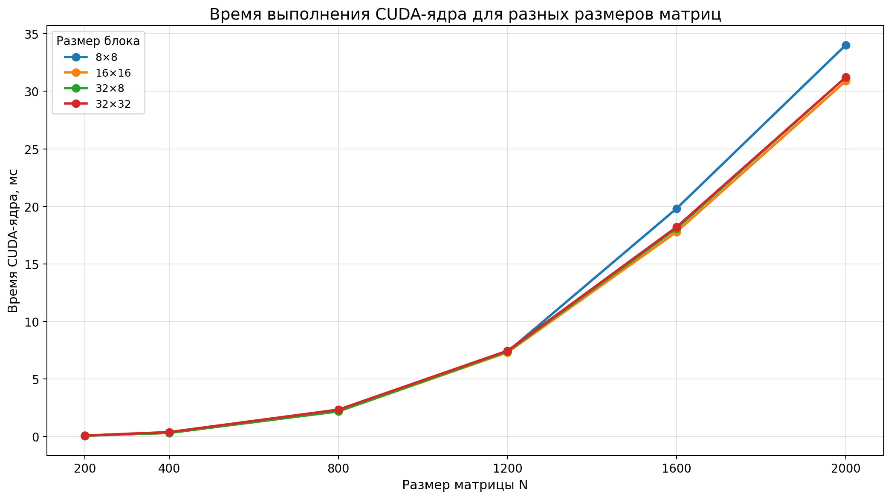
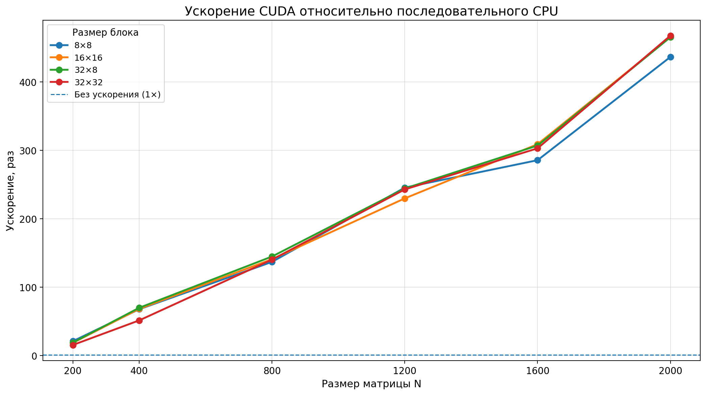

# Лабораторная работа №4 — Умножение матриц с использованием CUDA

**Выполнили:** Эльменкин Виктор Хавьерович и Дарьин Иван Борисович

**Группа:** 6213-100503D

**Программное и аппаратное обеспечение**
- **RAM**: 16 GB DDR4
- **CPU**: Intel Core i5-12400F
- **GPU**: NVIDIA GeForce RTX 3080
- **OS**: Windows 11 Pro

## Цель работы

Модифицировать программу из лабораторной работы №1 для параллельного умножения квадратных матриц с использованием технологии CUDA.

Провести эксперименты с матрицами различных размеров и различными конфигурациями сетки и блоков CUDA, сравнить производительность последовательной реализации на CPU и параллельной реализации на GPU, проверить корректность полученных результатов.

## Используемые технологии и оборудование

- **Язык программирования:** C++23.
- **Технология параллельных вычислений:** NVIDIA CUDA.
- **CUDA Toolkit:** 13.4.
- **Видеокарта:** NVIDIA GeForce RTX 3080 10 GB.
- **Архитектура CUDA:** Compute Capability 8.6 (`sm_86`).
- **Компилятор:** MSVC 19.51 (Visual Studio 2026).
- **Система сборки:** CMake 4.4.4 и Ninja.
- **CUDA C++:** C++20.
- **Проверка результатов:** Python и NumPy.
- **Построение графиков:** Matplotlib.

## Структура проекта

```text
Lab4/
│
├── CMakeLists.txt
├── main.cpp
│
├── matrix_core_n_files.cppm
├── matrix_ops.cppm
├── matrix_cuda.hpp
├── matrix_cuda.cu
│
├── gen.py
├── check.py
├── perf.py
├── run_all.ps1
│
├── README_CUDA.md
├── Readme.md
│
├── matrix_a.txt
├── matrix_b.txt
├── result.txt
├── benchmark.csv
│
├── performance_cpu_cuda_all_sizes.png
├── performance_cuda_total_all_sizes.png
├── performance_cuda_kernel_all_sizes.png
└── performance_cuda_speedup_all_sizes.png
```

Каталог `build/` содержит промежуточные файлы сборки, объектные файлы и исполняемую программу. Его не требуется загружать в GitHub.

## Описание файлов

| Файл | Назначение |
|---|---|
| `CMakeLists.txt` | Настройка сборки C++23-модулей и CUDA-кода. |
| `main.cpp` | Главная функция программы, загрузка матриц, последовательное умножение на CPU, запуск CUDA-экспериментов, измерение времени и проверка результатов. |
| `matrix_core_n_files.cppm` | Модуль с классом `Mat`, загрузкой и сохранением матриц, записью результатов экспериментов. |
| `matrix_ops.cppm` | Реализация последовательного и многопоточного умножения матриц на CPU с использованием `std::thread`. |
| `matrix_cuda.hpp` | Интерфейс для взаимодействия основной программы с CUDA-кодом. |
| `matrix_cuda.cu` | CUDA-ядро умножения матриц, управление памятью видеокарты, копирование данных и измерение времени. |
| `gen.py` | Генерация двух квадратных матриц со случайными значениями. |
| `check.py` | Независимая проверка результата умножения с помощью NumPy. |
| `perf.py` | Чтение `benchmark.csv` и построение четырёх графиков по всем размерам матриц. |
| `run_all.ps1` | Автоматический запуск экспериментов для нескольких размеров матриц. |
| `benchmark.csv` | Таблица с результатами измерений производительности. |
| `result.txt` | Результирующая матрица, полученная при запуске программы. |
| `performance_cpu_cuda_all_sizes.png` | Сравнение времени последовательного CPU и полного времени CUDA для всех размеров матриц. |
| `performance_cuda_total_all_sizes.png` | Сравнение полного времени CUDA для четырёх конфигураций блоков. |
| `performance_cuda_kernel_all_sizes.png` | Сравнение времени непосредственного выполнения CUDA-ядра. |
| `performance_cuda_speedup_all_sizes.png` | Ускорение CUDA относительно последовательного CPU. |

## Принцип работы программы

В программе реализовано умножение двух квадратных матриц A и B размером N × N.

Результирующая матрица C вычисляется по формуле:

$$
C_{ij} = \sum_{k=0}^{N-1} A_{ik} \cdot B_{kj}
$$

Для выполнения вычислений на GPU используется CUDA-ядро.

Каждый CUDA-поток отвечает за вычисление одного элемента результирующей матрицы.

Алгоритм работы CUDA-ядра:

1. Поток определяет координаты элемента результирующей матрицы с помощью `blockIdx`, `blockDim` и `threadIdx`.
2. Проверяет, что полученные индексы не выходят за границы матрицы.
3. Вычисляет скалярное произведение соответствующей строки первой матрицы и столбца второй матрицы.
4. Записывает полученное значение в результирующую матрицу.

Таким образом, разные CUDA-потоки одновременно вычисляют различные элементы результирующей матрицы.

## Конфигурации сетки и блоков CUDA

В ходе экспериментов используются четыре конфигурации CUDA-блоков:

| Размер блока | Количество потоков |
|---|---:|
| 8 × 8 | 64 |
| 16 × 16 | 256 |
| 32 × 8 | 256 |
| 32 × 32 | 1024 |

Размер сетки определяется исходя из размера матрицы и количества потоков в блоке.

Для вычисления количества блоков используется округление вверх:

$$
grid_x = \left\lceil \frac{N}{block_x} \right\rceil
$$

$$
grid_y = \left\lceil \frac{N}{block_y} \right\rceil
$$

Это позволяет покрыть все элементы матрицы, в том числе когда её размер не делится на размер блока без остатка.

Для каждой конфигурации выполняется предварительный запуск CUDA-ядра, после чего проводятся три измеряемых запуска. В таблицу результатов записываются средние значения времени.

## Измерение производительности

В программе измеряются три основных показателя:

- `sequential_ms` — время последовательного умножения матриц на CPU.
- `cuda_kernel_ms` — время непосредственного выполнения CUDA-ядра.
- `cuda_total_ms` — полное время CUDA-операции, включая выделение памяти GPU, копирование входных данных, выполнение ядра и копирование результата обратно на CPU.

Для измерения времени выполнения CUDA-ядра используются CUDA Events.

Ускорение вычислений рассчитывается по формуле:

$$
Speedup = \frac{T_{CPU}}{T_{CUDA}}
$$

В качестве времени CUDA используется полное время операции `cuda_total_ms`.

Лучшая конфигурация определяется по минимальному полному времени выполнения CUDA.

Результаты экспериментов записываются в `benchmark.csv`.

## Сборка проекта

Для сборки необходимы CUDA Toolkit 13.4, Visual Studio 2026 с компонентами C++, CMake и Ninja.

В данной конфигурации CUDA Toolkit установлен в каталог `D:\Данные`. Для корректной работы компоновщика MSVC используется виртуальный диск `Z:`, чтобы избежать проблем с кириллицей в пути к CUDA-библиотекам.

Откройте Developer PowerShell for Visual Studio 2026 и перейдите в каталог проекта:

```powershell
cd "C:\Parallel Programming\Lab4"
```

Создайте виртуальный диск, если он ещё не существует:

```powershell
subst Z: "D:\Данные"
```

Настройте переменные окружения:

```powershell
$env:CUDA_PATH = "Z:\"
$env:CUDA_PATH_V13_4 = "Z:\"
$env:Path = "Z:\bin;" + $env:Path
```

Настройте проект с помощью CMake:

```powershell
cmake -S . -B build -G Ninja `
    -DCMAKE_BUILD_TYPE=Release `
    "-DCMAKE_CUDA_COMPILER=Z:/bin/nvcc.exe" `
    "-DCUDAToolkit_ROOT=Z:/" `
    -DCMAKE_CUDA_ARCHITECTURES=86
```

Соберите проект:

```powershell
cmake --build build
```

После успешной сборки исполняемый файл находится по адресу:

```text
build/LabCUDA.exe
```

Если ранее была создана конфигурация с неправильными путями к CUDA, перед повторной настройкой рекомендуется удалить каталог `build`.

## Запуск одного эксперимента

Для генерации двух матриц размером 200 × 200 используется команда:

```powershell
py .\gen.py --size 200
```

Запуск программы:

```powershell
.\build\LabCUDA.exe
```

Проверка результата с помощью NumPy:

```powershell
py .\check.py
```

При успешной проверке программа выводит:

```text
RESULT: OK
```

## Запуск полной серии экспериментов

Для исследования зависимости производительности от размера матриц используется скрипт `run_all.ps1`.

Проверяемые размеры:

```text
200, 400, 800, 1200, 1600, 2000
```

Перед запуском необходимо разрешить выполнение локального PowerShell-сценария в текущем окне терминала:

```powershell
Set-ExecutionPolicy -Scope Process -ExecutionPolicy Bypass
```

Данная команда действует только в текущем процессе PowerShell и не изменяет постоянные настройки безопасности Windows.

Запуск серии экспериментов:

```powershell
.\run_all.ps1
```

Скрипт последовательно:

1. Генерирует две матрицы заданного размера.
2. Запускает программу `LabCUDA.exe`.
3. Выполняет умножение на CPU.
4. Проверяет четыре конфигурации CUDA.
5. Записывает результаты измерений в `benchmark.csv`.
6. Переходит к следующему размеру матриц.

После успешного выполнения всех шести размеров в `benchmark.csv` должно находиться 24 строки измерений, не считая строки заголовка.

## Построение графиков

После завершения экспериментов перейдите в каталог проекта. При необходимости установите Matplotlib:

```powershell
py -m pip install matplotlib
```

Постройте графики командой:

```powershell
py .\perf.py
```

Скрипт считывает все строки из `benchmark.csv` и сохраняет четыре PNG-файла рядом с `perf.py`. Каждый график включает все размеры матриц, которые присутствуют в CSV.

Полученные графики позволяют сравнить:

- время последовательного умножения на CPU;
- время выполнения CUDA-ядра;
- полное время CUDA-операции;
- ускорение для разных конфигураций блоков;
- влияние размера матрицы на производительность.

## Проверка корректности результатов

Для проверки корректности вычислений используются два способа.

**1. Проверка внутри программы на C++**

Результат CUDA сравнивается с результатом последовательного умножения на CPU с допустимой погрешностью `1e-9`.

Для каждой конфигурации выводится сообщение:

```text
Result check: OK
```

**2. Независимая проверка через NumPy**

Скрипт `check.py` загружает исходные матрицы и результат программы, после чего независимо вычисляет произведение с помощью NumPy.

Сравнение выполняется с использованием `numpy.allclose`.

В контрольном эксперименте для матриц 2000 × 2000 получен следующий результат:

```text
Maximum absolute difference: 0.000e+00
RESULT: OK
```

Это подтверждает корректность вычислений CUDA для проверенного размера матриц.

## Сводные результаты для всех размеров матриц

В таблице для каждого размера выбрана конфигурация с минимальным полным временем CUDA (`cuda_total_ms`).

| Размер матрицы | Лучшая конфигурация | CPU, мс | CUDA-ядро, мс | CUDA total, мс | Ускорение |
|---:|:---:|---:|---:|---:|---:|
| 200 × 200 | 8 × 8 | 9.0232 | 0.0669 | 0.4329 | 20.84× |
| 400 × 400 | 32 × 8 | 75.6015 | 0.3217 | 1.0849 | 69.69× |
| 800 × 800 | 32 × 8 | 625.1290 | 2.1898 | 4.3215 | 144.66× |
| 1200 × 1200 | 8 × 8 | 2892.3102 | 7.3709 | 11.7856 | 245.41× |
| 1600 × 1600 | 16 × 16 | 7949.1656 | 17.7863 | 25.7335 | 308.90× |
| 2000 × 2000 | 32 × 32 | 19953.6153 | 31.2190 | 42.6720 | 467.60× |

Из результатов видно, что наиболее эффективная конфигурация зависит от размера матрицы. Для небольших матриц минимальное полное время показал блок `8 × 8`, для размеров 400 × 400 и 800 × 800 — `32 × 8`, для 1200 × 1200 — `8 × 8`, для 1600 × 1600 — `16 × 16`, а для 2000 × 2000 — `32 × 32`.

## Результаты для матриц 2000 × 2000

Для размера 2000 × 2000 измерения из `benchmark.csv` дают следующие результаты:

| Конфигурация | Время ядра, мс | Полное время CUDA, мс | Ускорение |
|---|---:|---:|---:|
| 8 × 8 | 34.0148 | 45.7115 | 436.51× |
| 16 × 16 | 30.8866 | 42.8571 | 465.58× |
| 32 × 8 | 31.2106 | 42.8785 | 465.35× |
| 32 × 32 | 31.2190 | 42.6720 | 467.60× |

Время последовательного умножения на CPU составило `19953.6153 мс`.

Наименьшее полное время CUDA показала конфигурация `32 × 32` — `42.6720 мс`. Наименьшее время непосредственно CUDA-ядра показала конфигурация `16 × 16` — `30.8866 мс`. Следовательно, минимальное время ядра и минимальное полное время операции могут соответствовать разным конфигурациям блоков.

# Графики производительности

Все графики ниже построены по 24 измерениям из `benchmark.csv`: шесть размеров матриц и четыре конфигурации CUDA-блоков для каждого размера.

### График №1. Сравнение времени CPU и полного времени CUDA

Для наглядного отображения обеих реализаций используется логарифмическая шкала по оси времени: полное время CUDA значительно меньше времени последовательного CPU.



### График №2. Полное время CUDA для разных конфигураций блоков

На графике учитывается не только выполнение ядра, но и полная операция CUDA, включая работу с памятью и копирование данных.



### График №3. Время выполнения CUDA-ядра

График показывает время непосредственного выполнения вычислительного ядра без полного набора операций передачи данных.



### График №4. Ускорение CUDA относительно CPU

Ускорение рассчитано по полному времени CUDA (`cuda_total_ms`), а не только по времени ядра.



## Вывод

В ходе лабораторной работы программа из лабораторной работы №1 была модифицирована для выполнения параллельных вычислений с использованием технологии CUDA.

Было реализовано CUDA-ядро умножения квадратных матриц, в котором каждый поток вычисляет один элемент результирующей матрицы.

Проведено исследование различных конфигураций блоков CUDA: 8 × 8, 16 × 16, 32 × 8 и 32 × 32.

Для всех шести исследованных размеров матриц проведены измерения четырёх конфигураций CUDA-блоков. По данным `benchmark.csv`, полное ускорение CUDA увеличивается с ростом размера матрицы: от примерно 15–21 раза для матриц 200 × 200 до примерно 436–468 раз для матриц 2000 × 2000.

Единственной конфигурации, которая была бы оптимальной для всех размеров, не обнаружено. Минимальное полное время CUDA для разных размеров показали разные конфигурации блоков. Для матриц 2000 × 2000 лучший результат в этой серии получен с блоком 32 × 32: `42.6720 мс` и ускорение `467.60×` относительно последовательного CPU.

Таким образом, результаты эксперимента показывают, что эффективность CUDA зависит как от размера обрабатываемых матриц, так и от конфигурации блоков. При сравнении важно учитывать полное время CUDA-операции, поскольку время выполнения ядра не включает все накладные расходы на работу с памятью и передачу данных.
